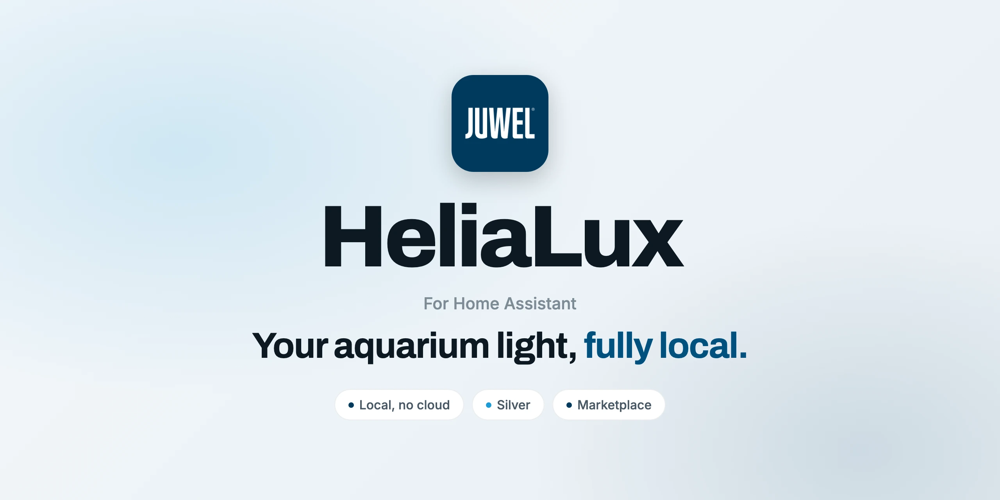

<div align="center">

<picture>
  <source media="(prefers-color-scheme: dark)" srcset="docs/images/readme-title-dark.webp" />
  
</picture>

[](https://github.com/SH1FT-W/helialux/releases/latest)
[](https://www.home-assistant.io)
[](https://hacs.xyz)

<a href="https://sh1ft-w.github.io/helialux"><b>Website</b></a>&emsp;<a href="#install">Install</a>&emsp;<a href="#set-up">Set up</a>&emsp;<a href="#entities">Entities</a>&emsp;<a href="#moving-over">Moving over</a>&emsp;<a href="CHANGELOG.md">Changelog</a>

</div>

<br/>

Your Juwel aquarium light in Home Assistant: **every channel as a slider, real transitions, profiles, clouds and a sun cycle.** Straight over the lamp's own web server in your Wi-Fi, without cloud. Built and tested on a Trigon 190 (HeliaLux SmartControl 4Ch, firmware 2.2.2, hardware 1.1C).

It needs a **HeliaLux SmartControl**; Juwel lamps without it have no web server and do not work. HeliaLux has its own domain `helialux` and runs next to [MrSleeps' Juwel HeliaLux integration](https://github.com/MrSleeps/Juwel-HeliaLux-Home-Assistant-Custom-Component). Nothing is taken over automatically, [moving over](#moving-over) keeps your entity IDs and history.

## What runs on the lamp

The lamp plays its own profile. Home Assistant writes that profile, or takes over with a manual colour.

|  | Where it lives | Without Home Assistant |
|:--|:--|:--|
| Profile with up to 16 points, weekly plan | Saved in the lamp | Keeps running |
| Clouds and cloud window | Written into the active profile | Keeps running |
| Sun cycle and acclimatization | Active profile recalculated every night at 03:05 | Last night's profile keeps running |
| Clouds from weather | Active profile, on change and at most every 30 minutes | Last clouds stay |
| Manual colour, sliders, transitions | The lamp's colour simulation, held by Home Assistant | Runs out, then the profile takes over |

**New in 26.11:** its own domain next to MrSleeps' integration, and the lamp is discovered on the network and follows a new IP address by itself. Every change is in the [changelog](CHANGELOG.md).

<a id="install"></a>
## Install

[](https://my.home-assistant.io/redirect/hacs_repository/?owner=SH1FT-W&repository=helialux&category=integration)

Search for **Juwel HeliaLux** under **Settings > Marketplace** (called HACS before Home Assistant 2026.11), pick the one **by SH1FT-W**, download it and restart Home Assistant.

<details>
<summary>Install by hand</summary>

1. Download the [latest release](https://github.com/SH1FT-W/helialux/releases/latest).
2. Copy `custom_components/helialux` into `/config/custom_components/` and restart Home Assistant.

</details>

<a id="set-up"></a>
## Set up

Before you start, reserve a fixed IP address for the lamp in your router and let it reach its time server (`ptbtime1.ptb.de`, UDP 123 outwards). Without the time, the profile runs at the wrong hour.

1. **Add the lamp.** It usually shows up under **Settings > Devices & services > Discovered**, recognised by its MAC address. If not, choose **Add integration > Juwel HeliaLux** and enter its IP address (protocol `http` by default, or `https`).
2. **Name the aquarium.** The name sets the device and the entity IDs: `Trigon 190` gives `light.trigon_190_light`. Moving over? Use the same name as before.
3. **Options, if you like.** Under **three dots > Configure**: poll every 5 to 300 seconds (default 15), and the weather entity for clouds from weather.

A new IP address is picked up by itself when Home Assistant sees the lamp's DHCP requests (same network), or after the next restart through a router integration such as UniFi. Otherwise use **three dots > Reconfigure**. One lamp per entry.

<a id="entities"></a>
## Entities

IDs for a tank named "Trigon 190". Names are in English and German.

| Entity | Shows |
|:--|:--|
| `light.trigon_190_light` | The lamp as RGBW with absolute channel values, brightness and `transition`. Switching on brings back the last mix. |
| `number.trigon_190_white`, `_blue`, `_green`, `_red` | One channel each, 0 to 100 %. Lamps with fewer channels get fewer sliders. |
| `switch.trigon_190_manual_color_simulation` | On = Home Assistant decides the colour, off = the lamp's profile. |
| `switch.trigon_190_keep_manual` | On, Home Assistant holds the manual colour for good. Off, the profile takes over again after the set duration. |
| `select.trigon_190_profil`, `select.trigon_190_profile_monday` … `_sunday` | Profile for all days or per weekday. |
| `sensor.trigon_190_current_profile` | Active profile. Attributes `curve` (points per channel), `profile_now` and `week`, for charts in dashboards. |

<details>
<summary>Clouds, sun cycle, acclimatization and diagnostics (more entities)</summary>

| Entity | Shows |
|:--|:--|
| `select.trigon_190_cloud_intensity`, `_cloud_motion` | Clouds in the active profile |
| `time.trigon_190_cloud_from`, `_cloud_to` | Cloud window: clouds only in this period |
| `switch.trigon_190_sun_cycle` + `time.trigon_190_sun_earliest`, `_sun_latest` | Morning and evening of the profile follow sunrise and sunset, within earliest and latest |
| `switch.trigon_190_acclimatization` + `number.trigon_190_acclim_start`, `_acclim_weeks` | The profile starts dimmed (10 to 100 %) and reaches full brightness after 1 to 12 weeks |
| `switch.trigon_190_weather_clouds` | Clouds from weather: condition or cloud coverage sets the strength, wind the motion |
| `switch.trigon_190_manual_daytime_simulation` + `number.trigon_190_daytime_simulation_position`, `_manual_daytime_simulation_duration` | Play the profile in fast motion from a start time |
| `number.trigon_190_manual_color_simulation_duration` | Duration the colour simulation is started with |
| `sensor.trigon_190_white`, `_blue`, `_green`, `_red` | Channel values in % |
| `sensor.trigon_190_device_time`, `_profiles` | Lamp clock, number of profiles |
| `binary_sensor.trigon_190_reachable` | Lamp reachable, with the last error (diagnostic) |
| `sensor.trigon_190_clock_offset`, `_color_simulation_remaining` | Diagnostic. From 10 minutes off, a notice appears under **Repairs**. |

</details>

## Examples

`rgbw_color` holds the **absolute** channel values (0 to 255 equals 0 to 100 %), just as the lamp shows them:

| Call | Result |
|:--|:--|
| only `rgbw_color` | exactly these channel values |
| `rgbw_color` + `brightness` | colour scaled so the brightest channel has `brightness` |
| only `brightness` | current mix brighter or darker |
| no values | stays as it is; if the lamp was off, the last mix comes back |

A one-hour sunrise:

```yaml
action: light.turn_on
target:
  entity_id: light.trigon_190_light
data:
  rgbw_color: [204, 140, 153, 255]   # red 80 %, green 55 %, blue 60 %, white 100 %
  transition: 3600
```

<details>
<summary>Set channels in percent with <code>helialux.set_channels</code></summary>

Missing channels stay as they are.

```yaml
action: helialux.set_channels
target:
  entity_id: light.trigon_190_light
data:
  white: 100
  blue: 60
  green: 55
  red: 80
  transition: 3600
```

</details>

<details>
<summary>Write a whole profile with <code>helialux.set_profile</code></summary>

`helialux.get_profile` reads a profile in the same format. The profile is saved permanently in the lamp. If 00:00 or 23:59 are missing, the last point is continued there (usually: off). Without `clouds` and `cloud_motion` the profile keeps its cloud setting. If someone is editing the same profile in the Juwel app at that moment, nothing is overwritten.

```yaml
action: helialux.set_profile
target:
  entity_id: light.trigon_190_light
data:
  profile: My_Profile           # name or slot (P1 to P8); empty = today's active profile
  points:
    - {time: "09:00", white: 0, blue: 0, green: 0, red: 0}
    - {time: "10:00", white: 100, blue: 60, green: 55, red: 80, clouds: 2, cloud_motion: 2}
    - {time: "19:40", white: 100, blue: 60, green: 55, red: 80, clouds: 2, cloud_motion: 2}
    - {time: "20:00", white: 25, blue: 8, green: 10, red: 30}
    - {time: "21:50", white: 25, blue: 8, green: 10, red: 30}
    - {time: "22:00", white: 0, blue: 0, green: 0, red: 0}
```

</details>

<a id="moving-over"></a>
## Moving over

From MrSleeps' integration, or from HeliaLux 26.11.2 and earlier (both use the domain `juwel_helialux`). Nothing is taken over automatically:

1. **Note the aquarium name** of the old entry. It sets the entity IDs.
2. **Give the profile back.** If used in HeliaLux, switch off **sun cycle** and **acclimatization**, so the original profile is written back to the lamp.
3. **Delete the old entry** under **Settings > Devices & services**. While it exists, the new entities get a `_2` suffix.
4. **Remove the old integration.** MrSleeps' one in the Marketplace. For HeliaLux 26.11.2 and earlier delete `/config/custom_components/juwel_helialux` by hand: the update installs into the new folder `helialux` and leaves the old one in place, and while it is there, HeliaLux refuses to set up a lamp and shows a repair notice. Restart Home Assistant.
5. **Set the lamp up again** with the **same aquarium name**. Entity IDs, history, statistics and automations that use entity IDs keep working.
6. **Rename actions** from `juwel_helialux.*` to `helialux.*` in automations and scripts.

Set again by hand: device automations, area, custom names and icons, labels, voice assistant and HomeKit exposure, disabled entities and entity IDs you renamed. Options and the colour simulation duration start at their defaults. Got a `_2` suffix anyway? Delete the new entry and set it up again with the same name.

## Good to know

- **Close the lamp's web interface.** While it is open in a browser, it sends its own slider values every second and overwrites Home Assistant.
- **One request at a time.** The lamp only handles one, so all commands run one after the other. Changes in the Juwel app show up within the poll interval.
- **Daytime simulation wins.** Start it on the lamp and Home Assistant steps back.
- **Your original profile is kept.** Sun cycle and acclimatization rewrite the active profile; when both are off, Home Assistant writes the original back.

<details>
<summary>Troubleshooting</summary>

- **All entities "unavailable".** The lamp did not answer three times in a row. Check its IP address in your router and use **three dots > Reconfigure**. Single lost requests are bridged.
- **Colour jumps back.** Usually the lamp's web interface is still open in a browser.
- **Profile runs at the wrong time.** See **Settings > Repairs**: the lamp clock cannot reach its time server.
- **"The lamp did not accept the command".** The lamp was not reachable or refused; the reason follows the colon.
- **Debug log:**

  ```yaml
  logger:
    logs:
      custom_components.helialux: debug
  ```

When you open an [issue](https://github.com/SH1FT-W/helialux/issues), attach the diagnostics (**Settings > Devices & services > Juwel HeliaLux > three dots > Download diagnostics**). They hold state, desired state and the last 20 events, without IP and MAC address.

</details>

<details>
<summary>Remove</summary>

1. If used, switch off **sun cycle** and **acclimatization** (the original profile goes back to the lamp) and the **manual colour simulation** (the profile runs again).
2. **Settings > Devices & services > Juwel HeliaLux > three dots > Delete.** The stored desired state is deleted with it.
3. Remove the repository in the Marketplace (or delete `/config/custom_components/helialux`) and restart Home Assistant.

</details>

<details>
<summary>How it works</summary>

| Path on the lamp | Used for | How often |
|:--|:--|:--|
| `statusvars.js` | Channels, mode, lamp clock | every 15 seconds (options) |
| `wpvars.js` | Profile names and weekly plan | every 10 minutes |
| `POST /stat` | Channels, colour and daytime simulation | on change |
| `/pedit`, `/week.html` | Profile points, clouds, weekly plan, saved permanently | on change |

Home Assistant remembers what it last wanted (mode, channels, last mix, end of the colour simulation) and holds it: a lost colour is restored (at most every 2 minutes), a colour simulation with less than 30 minutes left is extended, a change from the app or web interface is taken over. Protocol notes are in [`CLAUDE.md`](CLAUDE.md) (German).

HeliaLux is a rewrite and contains no code from [MrSleeps' integration](https://github.com/MrSleeps/Juwel-HeliaLux-Home-Assistant-Custom-Component) or [moretea/pyHelialux](https://github.com/moretea/pyHelialux); thanks to both for the groundwork.

</details>

<details>
<summary>Development</summary>

```bash
python -m pytest -q -p no:logging --cov=custom_components/helialux   # fake lamp in tests/conftest.py
uvx ruff check . && uvx ruff format --check .
uvx mypy@2.3.1 --python-executable <venv>/bin/python
python tools/pruefe-uebersetzungen.py    # strings.json against translations/*.json
```

Test requirements: `pip install -r requirements_test.txt`. The fake lamp answers like a real one, recorded from it. GitHub Actions runs the same checks plus HACS validation and hassfest. Quality scale: silver, [self-assessed](custom_components/helialux/quality_scale.yaml).

</details>

## License

[Apache License 2.0](LICENSE), Copyright 2026 SH1FT-W. Acknowledgements in [`NOTICE`](NOTICE).

<sub>HeliaLux is an independent project, not affiliated with, endorsed or sponsored by Juwel Aquarium AG & Co. KG. Juwel and HeliaLux are trademarks of Juwel Aquarium AG & Co. KG.</sub>
