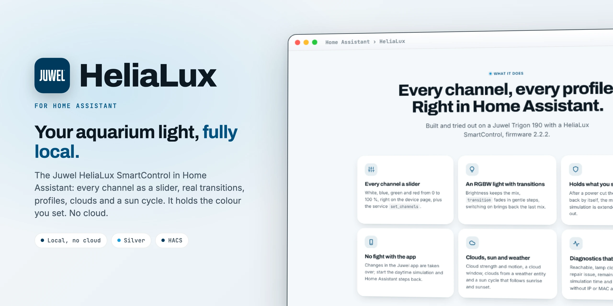

<div align="center">

<picture>
  <source media="(prefers-color-scheme: dark)" srcset="docs/images/readme-title-dark.webp" />
  
</picture>

<p>Local control for the Juwel HeliaLux SmartControl aquarium light in Home Assistant.<br/>
Robust, complete, no cloud.</p>

[](https://github.com/SH1FT-W/helialux/releases/latest)
[](https://www.home-assistant.io)
[](https://hacs.xyz)
[](https://developers.home-assistant.io/docs/creating_integration_manifest/#iot-class)
[-003A5D?style=flat-square&labelColor=111111)](custom_components/juwel_helialux/quality_scale.yaml)
[](LICENSE)

<p><a href="https://sh1ft-w.github.io/helialux"><b>Website</b></a> &nbsp;·&nbsp; <a href="#new">New</a> &nbsp;·&nbsp; <a href="#features">Features</a> &nbsp;·&nbsp; <a href="#entities">Entities</a> &nbsp;·&nbsp; <a href="#installation">Install</a> &nbsp;·&nbsp; <a href="#migration-from-mrsleeps-integration">Migration</a> &nbsp;·&nbsp; <a href="#troubleshooting">Troubleshooting</a> &nbsp;·&nbsp; <a href="CHANGELOG.md">Changelog</a></p>

</div>

<br/>

HeliaLux controls the LED lighting of Juwel aquariums with a **HeliaLux SmartControl** over the lamp's own web server in your Wi-Fi. It was built and tested on a **Trigon 190** (SmartControl 4Ch, firmware 2.2.2, hardware 1.1C).

It replaces [MrSleeps' Juwel HeliaLux integration](https://github.com/MrSleeps/Juwel-HeliaLux-Home-Assistant-Custom-Component) and **keeps its domain `juwel_helialux` and its unique IDs**, so entities, history, device, automations and dashboards stay the same when you switch.

> [!NOTE]
> HeliaLux is an independent project. It is not affiliated with, endorsed by or sponsored by Juwel Aquarium AG & Co. KG. Juwel and HeliaLux are trademarks of Juwel Aquarium AG & Co. KG.

<br/>

<a id="new"></a>
<sub><b>JUST ARRIVED</b></sub>
## Steadier profiles, quieter logs.

<!-- cards:new -->
<table>
<tr><td width="50%" valign="top"><picture><source media="(prefers-color-scheme: dark)" srcset="docs/images/icons/chart-bell-curve-dark.svg"></picture> <b>True to the profile</b> <code>26.10.2</code><br>Before the first point of a profile the value of that point applies, exactly as on the lamp, instead of a wrongly extrapolated one.</td><td width="50%" valign="top"><picture><source media="(prefers-color-scheme: dark)" srcset="docs/images/icons/form-textbox-lock-dark.svg"></picture> <b>Safe profile names</b> <code>26.10.2</code><br>Names with characters the lamp cannot store are rejected before saving, so a profile on the lamp is never mangled.</td></tr>
<tr><td width="50%" valign="top"><picture><source media="(prefers-color-scheme: dark)" srcset="docs/images/icons/weather-windy-dark.svg"></picture> <b>Wind in any unit</b> <code>26.10.2</code><br>Clouds from weather convert knots and feet per second correctly. Holding the state starts only once, even for two quick polls.</td><td width="50%" valign="top"><picture><source media="(prefers-color-scheme: dark)" srcset="docs/images/icons/calendar-outline-dark.svg"></picture> <b>Calendar versions</b> <code>26.10.1</code><br>Year, month and the release of that month: 26.10.2 is the second release of October 2026. The jump from 1.0.1 is intended, updates show up as usual.</td></tr>
</table>
<!-- /cards:new -->

Every change, release by release, in the [changelog](CHANGELOG.md).

<a id="features"></a>
## Features

<!-- cards:features -->
<table>
<tr><td width="50%" valign="top"><picture><source media="(prefers-color-scheme: dark)" srcset="docs/images/icons/tune-vertical-dark.svg"></picture> <b>Every channel a slider</b><br>White, blue, green and red from 0 to 100 %, right on the device page, plus the service set_channels.</td><td width="50%" valign="top"><picture><source media="(prefers-color-scheme: dark)" srcset="docs/images/icons/lightbulb-on-outline-dark.svg"></picture> <b>An RGBW light with transitions</b><br>Brightness keeps the mix, transition fades in gentle steps, switching on brings back the last mix instead of 100 % white.</td></tr>
<tr><td width="50%" valign="top"><picture><source media="(prefers-color-scheme: dark)" srcset="docs/images/icons/shield-check-outline-dark.svg"></picture> <b>Holds what you set</b><br>After a power cut or lamp restart the colour comes back by itself, the manual colour simulation is extended before it runs out.</td><td width="50%" valign="top"><picture><source media="(prefers-color-scheme: dark)" srcset="docs/images/icons/cellphone-dark.svg"></picture> <b>No fight with the app</b><br>Changes in the Juwel app are taken over. Start the daytime simulation and Home Assistant steps back.</td></tr>
<tr><td width="50%" valign="top"><picture><source media="(prefers-color-scheme: dark)" srcset="docs/images/icons/calendar-week-dark.svg"></picture> <b>Profiles and weekly plan</b><br>Read and write whole profiles with get_profile and set_profile, one profile for all days or one per weekday.</td><td width="50%" valign="top"><picture><source media="(prefers-color-scheme: dark)" srcset="docs/images/icons/weather-partly-cloudy-dark.svg"></picture> <b>Clouds, sun and weather</b><br>Cloud strength and motion, a cloud window, clouds from a weather entity and a sun cycle that follows sunrise and sunset.</td></tr>
<tr><td width="50%" valign="top"><picture><source media="(prefers-color-scheme: dark)" srcset="docs/images/icons/sprout-outline-dark.svg"></picture> <b>Acclimatization</b><br>A new tank starts dimmed (10 to 100 %) and reaches full brightness after 1 to 12 weeks.</td><td width="50%" valign="top"><picture><source media="(prefers-color-scheme: dark)" srcset="docs/images/icons/stethoscope-dark.svg"></picture> <b>Robust, with diagnostics</b><br>One request at a time, lost commands repeated, unavailable only after three misses. Clock offset repair issue and a diagnostics download.</td></tr>
</table>
<!-- /cards:features -->

- **Keep manual colour:** on, Home Assistant holds the colour permanently; off, the lamp's profile takes over again after the set duration (handy for a quick manual tweak).
- **Profile curve as data:** points per channel, clouds and what the profile would show right now, for charts in dashboards.
- **Repair issue:** if the lamp's clock is more than 10 minutes off, a notice appears under *Repairs*.

<a id="entities"></a>
## Entities

<!-- cards:entities -->
<table>
<tr><td width="50%" valign="top"><picture><source media="(prefers-color-scheme: dark)" srcset="docs/images/icons/lightbulb-outline-dark.svg"></picture> <b>Light</b><br>light.trigon_190_light: RGBW with absolute channel values (0 to 255 = 0 to 100 %), brightness and transition.</td><td width="50%" valign="top"><picture><source media="(prefers-color-scheme: dark)" srcset="docs/images/icons/tune-variant-dark.svg"></picture> <b>Channel numbers</b><br>white, blue, green and red from 0 to 100 %, plus the durations of the colour and daytime simulation.</td></tr>
<tr><td width="50%" valign="top"><picture><source media="(prefers-color-scheme: dark)" srcset="docs/images/icons/toggle-switch-outline-dark.svg"></picture> <b>Switches</b><br>manual_color_simulation, manual_daytime_simulation, keep_manual, sun_cycle, acclimatization and weather_clouds.</td><td width="50%" valign="top"><picture><source media="(prefers-color-scheme: dark)" srcset="docs/images/icons/form-dropdown-dark.svg"></picture> <b>Selects and times</b><br>profil, profile_monday to _sunday, cloud_intensity and cloud_motion. cloud_from, cloud_to, sun_earliest and sun_latest.</td></tr>
<tr><td width="50%" valign="top"><picture><source media="(prefers-color-scheme: dark)" srcset="docs/images/icons/information-outline-dark.svg"></picture> <b>Sensors</b><br>Channel values in %, current_profile with the attributes curve, profile_now and week, device_time and profiles.</td><td width="50%" valign="top"><picture><source media="(prefers-color-scheme: dark)" srcset="docs/images/icons/stethoscope-dark.svg"></picture> <b>Diagnostics</b><br>reachable with the last error, clock_offset and color_simulation_remaining.</td></tr>
</table>
<!-- /cards:entities -->

All IDs start with the tank name, for example `light.trigon_190_light`, and are the same as in the previous integration. Entity names are available in English and German.

<details>
<summary>All entities (for a tank named "Trigon 190")</summary>

| Entity | Meaning |
|---|---|
| `light.trigon_190_light` | The lamp (RGBW, absolute channel values, `transition`) |
| `number.trigon_190_white` / `_blue` / `_green` / `_red` | Set one channel (0 to 100 %) |
| `switch.trigon_190_manual_color_simulation` | On = Home Assistant decides the colour, off = the lamp's profile |
| `switch.trigon_190_manual_daytime_simulation` | Play the profile in fast motion from a start time |
| `select.trigon_190_profil` | Lamp profile (all days) |
| `select.trigon_190_profile_monday` … `_sunday` | Profile per weekday |
| `select.trigon_190_cloud_intensity` / `_cloud_motion` | Clouds in the active profile |
| `switch.trigon_190_keep_manual` | Keep manual colour |
| `time.trigon_190_cloud_from` / `_cloud_to` | Cloud window: clouds only in this period |
| `switch.trigon_190_sun_cycle` + `time.trigon_190_sun_earliest` / `_sun_latest` | Sun cycle: morning and evening of the profile follow sunrise and sunset, limited to earliest/latest |
| `switch.trigon_190_acclimatization` + `number.trigon_190_acclim_start` / `_acclim_weeks` | Acclimatization: the profile starts dimmed (10 to 100 %) and reaches full brightness after 1 to 12 weeks |
| `switch.trigon_190_weather_clouds` | Clouds from weather (choose the weather entity in the options) |
| `sensor.trigon_190_white` / `_blue` / `_green` / `_red` | Channel values in % |
| `sensor.trigon_190_current_profile` | Active profile; attributes `curve`, `profile_now`, `week` |
| `sensor.trigon_190_device_time`, `_profiles` | Lamp clock, number of profiles |
| `number.trigon_190_manual_color_simulation_duration` | Duration the colour simulation is started with |
| `number.trigon_190_daytime_simulation_position` / `_manual_daytime_simulation_duration` | Daytime simulation |
| `binary_sensor.trigon_190_reachable` | Diagnostic: lamp reachable (with the last error) |
| `sensor.trigon_190_clock_offset`, `_color_simulation_remaining` | Diagnostic |

</details>

### Colour values

`rgbw_color` holds the **absolute** channel values (0 to 255 equals 0 to 100 %), just as the lamp shows them:

| Call | Result |
|---|---|
| only `rgbw_color` | exactly these channel values |
| `rgbw_color` + `brightness` | colour scaled so the brightest channel has `brightness` |
| only `brightness` | current mix brighter or darker |
| no values | stays as it is; if the lamp was off, the last mix comes back |

```yaml
action: light.turn_on
target:
  entity_id: light.trigon_190_light
data:
  rgbw_color: [204, 140, 153, 255]   # red 80 %, green 55 %, blue 60 %, white 100 %
  transition: 3600                   # a one-hour sunrise
```

### Service `set_channels`

```yaml
action: juwel_helialux.set_channels
target:
  entity_id: light.trigon_190_light
data:
  white: 100
  blue: 60
  green: 55
  red: 80
  transition: 3600   # sunrise over one hour
```

Missing channels stay as they are.

### Read and write profiles

The lamp can play its daily schedule by itself (profile, up to 16 points, smooth transitions, clouds). `get_profile` reads a profile, `set_profile` writes one, in the same format:

```yaml
action: juwel_helialux.set_profile
target:
  entity_id: light.trigon_190_light
data:
  profile: My_Profile           # name or slot (P1 to P8); empty = today's active profile
  points:
    - {time: "09:00", white: 0, blue: 0, green: 0, red: 0}
    - {time: "10:00", white: 100, blue: 60, green: 55, red: 80, clouds: 2, cloud_motion: 2}
    - {time: "19:40", white: 100, blue: 60, green: 55, red: 80, clouds: 2, cloud_motion: 2}
    - {time: "20:00", white: 25, blue: 8, green: 10, red: 30}
    - {time: "21:50", white: 25, blue: 8, green: 10, red: 30}
    - {time: "22:00", white: 0, blue: 0, green: 0, red: 0}
```

If 00:00 or 23:59 are missing, the last point is continued there (usually: off). Without `clouds`/`cloud_motion` the profile keeps its cloud setting. The profile is saved permanently in the lamp; if someone is editing the same profile in the Juwel app at that moment, nothing is overwritten.

## Supported devices

- **Juwel HeliaLux SmartControl** in Wi-Fi, firmware 2.2.2 (hardware 1.1C). Tested on a Trigon 190 with four channels (white, blue, green, red). If a lamp has fewer channels, the integration only creates as many channel sliders.
- Not supported: Juwel lamps without SmartControl (without their own web server in Wi-Fi).

## Installation

### HACS (custom repository)

1. In HACS, open the three dots menu, choose **Custom repositories** and add `https://github.com/SH1FT-W/helialux` with the type **Integration**.
2. Search for **Juwel HeliaLux**, download it and restart Home Assistant.

### Manual

1. Download the [latest release](https://github.com/SH1FT-W/helialux/releases/latest).
2. Copy the folder `custom_components/juwel_helialux` into `/config/custom_components/` and restart Home Assistant.

Requires Home Assistant 2026.9 or newer.

## Setup

**Settings > Devices & services > Add integration > Juwel HeliaLux**:

| Field | Meaning |
|---|---|
| IP address | Address of the SmartControl in your Wi-Fi (best reserved in the router) |
| Aquarium name | Sets the device name and entity IDs (`Trigon 190` → `light.trigon_190_light`) |
| Protocol | `http` (default) or `https` |

Before creating the entry the integration queries the lamp; if it does not answer, "The lamp does not respond" appears. A new IP address can be entered later with **three dots > Reconfigure** (the name stays).

### Options

| Option | Meaning |
|---|---|
| Poll every … seconds | 5 to 300, default 15 |
| Weather for "clouds from weather" | Weather entity: the condition or cloud coverage sets the cloud strength, the wind the cloud motion. Written only on change and at most every 30 minutes |

## Migration from MrSleeps' integration

1. In HACS, remove "Juwel Helialux Smart Controller". Keep the integration entry.
2. Install HeliaLux (see above) and restart Home Assistant.
3. The existing entry is taken over: entity IDs, history, device and automations stay.

Three entities of the old integration remain as "no longer provided" (`sensor.<name>_combined_sensor` and two duplicate `binary_sensor.<name>_manual_*`); they can be deleted.

## Good to know

- **Do not leave the lamp's web interface open.** While it is open in a browser, it sends its own slider values every second and overwrites Home Assistant.
- **Lamp clock:** the lamp sets its clock by NTP (`ptbtime1.ptb.de`). If it has no internet access, UDP 123 has to be allowed outwards, otherwise the profile runs at the wrong time.
- **Data updates:** Home Assistant reads the state every 15 seconds (options) and the profile names every 10 minutes. Changes in the Juwel app therefore show up with up to 15 seconds delay. The lamp only handles one request at a time; all commands run one after the other.
- **Sun cycle and acclimatization** recalculate the active profile every night at 03:05 and write it to the lamp. Home Assistant keeps the original; when both are off, it is written back.
- **One lamp per entry, no automatic discovery.** Each lamp is set up by its IP address.

## Troubleshooting

- **All entities "unavailable".** The lamp did not answer three times in a row. Check the IP address in your router and enter it with **three dots > Reconfigure** if needed. Single lost requests are bridged.
- **Colour jumps back.** Usually the lamp's web interface is still open in a browser (see above).
- **Profile runs at the wrong time.** See the notice under *Repairs*: the lamp clock cannot reach its NTP server.
- **"The lamp did not accept the command".** The lamp was not reachable or refused; the reason follows the colon.
- **Diagnostics:** **Settings > Devices & services > Juwel HeliaLux > three dots > Download diagnostics**, with state, desired state and the last 20 events, without IP address and MAC address.
- **Debug log:**

  ```yaml
  logger:
    logs:
      custom_components.juwel_helialux: debug
  ```

When you open an [issue](https://github.com/SH1FT-W/helialux/issues), please attach the diagnostics file.

## Removal

1. If used: switch off **sun cycle** and **acclimatization**, so Home Assistant writes the original profile back to the lamp. Switch off the manual colour simulation so the profile runs again.
2. **Settings > Devices & services > Juwel HeliaLux > three dots > Delete.** The stored desired state is deleted with it.
3. Delete the folder `/config/custom_components/juwel_helialux` (or remove the repository in HACS) and restart Home Assistant.

## How it works

<!-- cards:how -->
<table>
<tr><td width="33%" valign="top"><picture><source media="(prefers-color-scheme: dark)" srcset="docs/images/icons/download-network-outline-dark.svg"></picture> <b>statusvars.js</b><br>Channels, mode and the lamp clock, every 15 seconds over the lamp's own web server.</td><td width="33%" valign="top"><picture><source media="(prefers-color-scheme: dark)" srcset="docs/images/icons/palette-outline-dark.svg"></picture> <b>POST /stat</b><br>Channels, colour and daytime simulation, one request after the other.</td><td width="33%" valign="top"><picture><source media="(prefers-color-scheme: dark)" srcset="docs/images/icons/calendar-edit-dark.svg"></picture> <b>/pedit and /week.html</b><br>Profile points, clouds and the weekly plan, saved permanently in the lamp.</td></tr>
</table>
<!-- /cards:how -->

Everything runs locally over the lamp's web server. Home Assistant remembers what it last wanted (mode, channels, last mix, end of the colour simulation) and holds that state: if the lamp lost its colour, it is restored (at most every 2 minutes); less than 30 minutes left, the simulation is extended; changed in the app or web interface, the change is taken over; daytime simulation started on the lamp, Home Assistant steps back. Protocol notes are in [`CLAUDE.md`](CLAUDE.md) (German).

HeliaLux is a rewrite and contains no code from [MrSleeps' integration](https://github.com/MrSleeps/Juwel-HeliaLux-Home-Assistant-Custom-Component) or [moretea/pyHelialux](https://github.com/moretea/pyHelialux); thanks to both for the groundwork.

## Development

```bash
python -m pytest -q -p no:logging --cov=custom_components/juwel_helialux   # fake lamp in tests/conftest.py
uvx ruff check . && uvx ruff format --check .
uvx mypy@2.3.1 --python-executable <venv>/bin/python
python tools/pruefe-uebersetzungen.py    # strings.json against translations/*.json
```

Install the test requirements with `pip install -r requirements_test.txt`. The tests run against a simulated lamp whose answers were recorded from a real one. The same checks run on GitHub Actions for every push and pull request, plus HACS validation and hassfest. Self-assessed state of the [Integration Quality Scale](https://developers.home-assistant.io/docs/core/integration-quality-scale/): [`quality_scale.yaml`](custom_components/juwel_helialux/quality_scale.yaml).

## License

[Apache License 2.0](LICENSE), Copyright 2026 SH1FT-W. See [`NOTICE`](NOTICE) for acknowledgements and trademarks.
